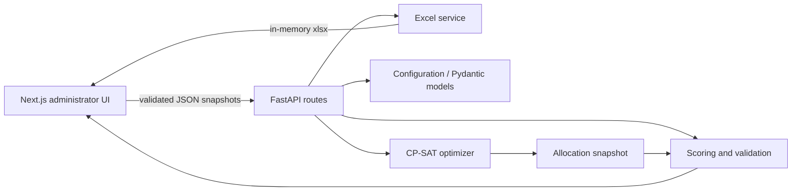

# AIP Smart Group Allocator

For the current six-activity Week 2 implementation, university category review,
support roles, prayer-aware scheduling, complete hotel manifest, and release
verification, see [Week 2 improvements](docs/week2-seven-improvements.md).

An explainable, local-first tool for creating permanent onboarding groups and temporary activity groups using university diversity, gender balance, and different teammate exposure.

## What is included

- Next.js 15, React 19, TypeScript, Tailwind, Lucide and Recharts dashboard
- Stateless FastAPI API with Pydantic validation
- Google OR-Tools CP-SAT joint allocation across activities
- A simple three-step journey: add participants, choose sizes, view results
- Independent preferred maximum group size for each activity
- Locked main-group preservation and validated participant swaps API
- Exact collaboration scoring, normalized comparison metrics, scenario API
- Safe, styled multi-sheet Excel export and blank workbook template
- Deterministic backend tests for 20, 25, 27, 29, 30, and 40 people

## Architecture



The deployable application is contained in `frontend/`. Its MVC-style boundaries are:

- **View:** `frontend/app` and `frontend/components` (Next.js and React).
- **Controller:** `frontend/backend/app/main.py` (FastAPI HTTP routes).
- **Model/services:** `frontend/backend/app/models.py`, `frontend/backend/app/services`, and `frontend/backend/data`.
- **Vercel entry point:** `frontend/api/index.py`, which exposes the FastAPI application alongside Next.js in one Vercel project.

There is no database. Participant and allocation state remains in the browser, while each API request carries the complete snapshot required by the stateless backend.

## Deploy the complete app to Vercel

Create one Vercel project from this repository and set its **Root Directory** to `frontend`. Vercel builds the Next.js interface and the FastAPI entry point in `api/index.py` from that same folder. Production browser requests use same-origin `/api` routes, so `NEXT_PUBLIC_API_URL` is not required on Vercel.

Vercel automatically detects the FastAPI `app` exported by `api/index.py`, while `.python-version` selects Python 3.12. For local development, run the Next.js and FastAPI development servers separately as described below; the frontend automatically uses `http://localhost:8000` in development unless `NEXT_PUBLIC_API_URL` overrides it.

Participant data is sent explicitly with each operation and is not stored by the server. Configuration presets contain no participant records.

## Run on macOS

Requirements: Python 3.9+ and Node.js 20+.

Terminal 1:

```bash
cd /Users/desta/Deloitte_AIP_Project
python3 -m venv .venv
source .venv/bin/activate
pip install -r frontend/requirements.txt
cd frontend/backend
uvicorn app.main:app --reload --port 8000
```

Terminal 2:

```bash
cd /Users/desta/Deloitte_AIP_Project/frontend
npm install
npm run dev
```

Open [http://localhost:3000](http://localhost:3000). API documentation is at [http://localhost:8000/docs](http://localhost:8000/docs).

If the API runs elsewhere, create `frontend/.env.local` with `NEXT_PUBLIC_API_URL=http://host:port`.

## Normal workflow

Upload an `.xlsx` file containing `Name`, `Gender`, and `University`, or choose **Enter Manually** and create 1–60 participant rows. Gender is limited to Male or Female and common M/F variations normalize automatically. Review participants, choose maximum group sizes with the stepper buttons, generate directly from that page, review the three activity tabs, and download the shareable PDF. Duplicate names remain distinct through unique generated IDs. Missing values are never inferred.

The blank template includes a Male/Female Excel dropdown for rows 2–201. Fictional data is retained only for automated development tests. Final results export as `AIP_Group_Allocations.pdf` with one page per activity and activity names, team names, and participant names only.

## How optimization works

Every person is constrained to exactly one group in every optimized activity. Every group has its exact balanced target size. Locked activities are copied into the model's history and are never changed. For each participant pair and activity, a Boolean variable records whether the pair shares a group. The primary soft cost is:

`sum(max(0, number_of_shared_activities(pair) - 1))`

The weighted objective is lexicographic by construction: one fewer same-university pair outweighs every possible gender or teammate improvement; one gender-deviation improvement outweighs every possible repeat improvement. Unknown university and gender values are excluded rather than invented. For fixed group sizes, reducing repeat encounters increases aggregate distinct teammate exposure. The solver reports `OPTIMAL` only when CP-SAT proves it; otherwise it reports `FEASIBLE`. A seeded valid fallback is available if a time-limited run finds no CP-SAT incumbent.

The balance score shown in analytics is `1 - mean absolute category-proportion deviation`, calculated across groups and activities. Missing values are excluded. The normalized unique-pair rate divides distinct teammate pairs by total teammate encounters; raw pair counts should not be compared directly when group sizes differ.

## Egyptian university directory

`frontend/backend/data/university_directory.json` is the shared, versioned source for manual autocomplete, Excel normalization, scoring, and optimization. It currently contains 133 university-level institutions and branches across 10 categories. Higher institutes and training centers are deliberately excluded. Each entry records a stable ID, English name, verified Arabic name where available, aliases, category, official source URL, and verification date.

The directory was reconciled on 2026-11-03 against the State Information Service updated accredited-institutions list and the Supreme Council of Universities category/branch pages. Official lists can differ temporarily in counts and English naming; entries that appear only on an SCU category page retain that page as their source. Regenerate the JSON after reviewing updates by editing and running `frontend/backend/data/generate_universities.py`.

Recognized aliases resolve to a stable university ID. Unknown foreign or newly established universities remain distinct custom IDs and are never fuzzily merged. Arabic search normalizes letter variants only for matching; it does not change the displayed value of an unrecognized custom entry.

## Checks

```bash
cd frontend/backend && ../../.venv/bin/pytest -q
cd .. && npm run typecheck && npm run build
```

## API highlights

`/api/upload`, `/api/participants/validate`, `/api/optimize`, `/api/allocations/validate`, `/api/allocations/score`, `/api/allocations/swap`, `/api/export/pdf`, and `/api/sample-template`.

## Privacy and deployment

This prototype uses fictional records, adds no telemetry, sends nothing to AI services, and makes no employment decisions. Before using real employee data, obtain privacy, HR, information-security, legal, accessibility, hosting, retention, and role-based-access-control review. Add authentication, authorization, encrypted transport, audit trails, retention controls, secrets management, malware scanning, and an approved hosting boundary. Sensitive factors should be enabled only with explicit authorization.

## Known limitations

- Browser session state is intentionally not durable.
- The UI exposes activity locking; the swap endpoint is implemented and validated, while a dedicated drag-and-drop swap dialog is not included.
- University alias/reference imports and verified ownership/affiliation administration are not yet implemented.
- The random-baseline and multi-run scenario APIs are architected but the current UI scorecard compares the active scenario only.
- Ordered categorical and advanced numeric-diversity objectives require strategy-specific extensions.
- CP-SAT is tuned for the recommended 20–60-person range; larger cohorts need performance benchmarking.

These are deliberately documented rather than represented as completed functionality.
# AIP-Group-Allocator
